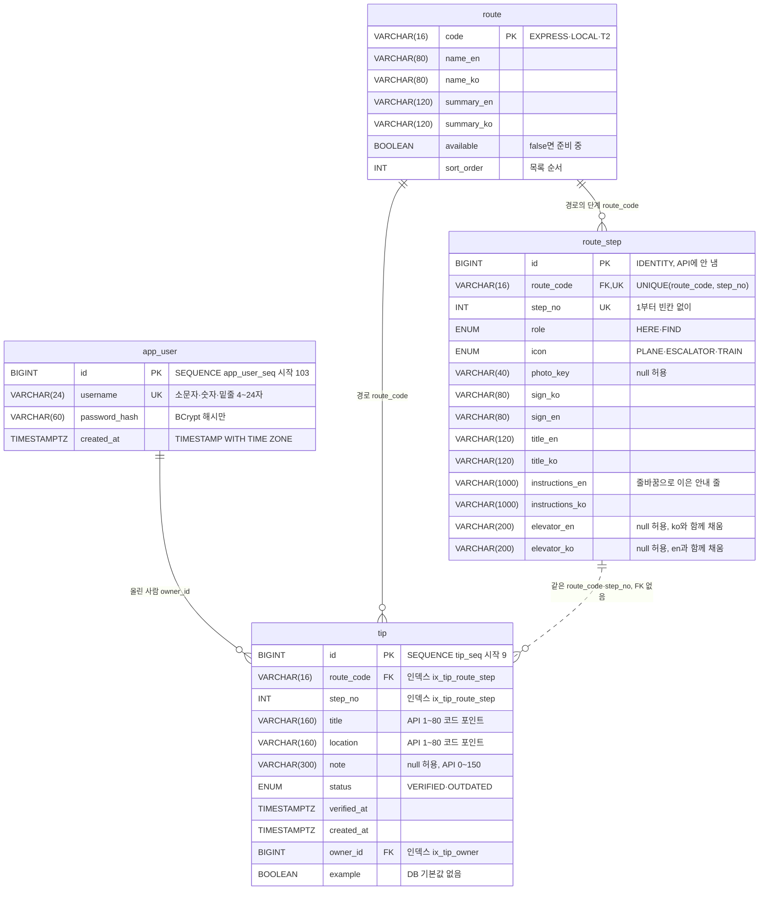

# 데이터 모델 · ICN Subway Steps

문서 정보: 2026-10-20 · 2026-10-21 DB 감사(코드·문서 일치, 디자인 충분성) 반영 · 근거 docs/requirements.md, docs/ui-handoff.md '화면 항목과 데이터 이름', 시안 v03(ROUTES·tips) · 작성 Claude Code, 검토: (본인 이름)

DB는 H2 2.4.240 파일 DB `./data/icn-subway`(프로젝트 폴더 기준)이고, 표는 JPA(`spring.jpa.hibernate.ddl-auto=update`)가 만든다.
API 계약은 docs/api-spec.yaml이 기준이다. JSON은 camelCase(stepNo, ownerId, verifiedAt), DB 열은 snake_case(step_no, owner_id, verified_at)다.
docs/schema.sql은 엔티티로 만든 create 스크립트(CREATE 문, 참고용)다. 실행용 DB의 표 정의 그대로는 아니다. 실행 설정(ddl-auto=update)이 새 DB에 보내는 DDL과 열 순서·UNIQUE 방식이 다르다(그 파일 머리말). 테스트 SchemaScriptTest가 그 파일이 지금 엔티티와 같은지 확인한다.

## 관계

- 실선은 외래 키(FK)다. tip.owner_id → app_user.id(올린 사람. 실제 단계의 주인이 아니다), tip.route_code → route.code, route_step.route_code → route.code.
- 점선(route_step ↔ tip)은 외래 키가 아니다. tip.step_no는 route_step을 가리키지 않고, 등록할 때 서비스가 1~그 경로의 단계 수인지만 확인한다.
  그래서 팁이 달린 단계의 번호를 바꾸거나 단계를 끼워 넣으면 팁은 같은 번호의 다른 단계에 붙는다(검토 메모 10).
- 그림의 TIMESTAMPTZ는 TIMESTAMP WITH TIME ZONE(정밀도 6), ENUM은 H2 ENUM 열이다(아래 표).

## app_user

| 열 | 자료형 | 필수 | 키·제약 | 정하는 쪽 | 설명 |
| --- | --- | --- | --- | --- | --- |
| id | BIGINT | 예 | PK, SEQUENCE app_user_seq 시작 103, 증가 1 | 서버 | 표본 101·102는 고정 번호로 넣음 |
| username | VARCHAR(24) | 예 | UNIQUE, `^[a-z0-9_]{4,24}$` | 사용자 | 중복이면 409 |
| password_hash | VARCHAR(60) | 예 | BCrypt(강도 10) | 서버 | 응답·로그에 내보내지 않음 |
| created_at | TIMESTAMP WITH TIME ZONE | 예 | | 서버 | |

## route

| 열 | 자료형 | 필수 | 키·제약 | 설명 |
| --- | --- | --- | --- | --- |
| code | VARCHAR(16) | 예 | PK | EXPRESS · LOCAL · T2 (대소문자 구분) |
| name_en / name_ko | VARCHAR(80) | 예 | | 경로 이름 |
| summary_en / summary_ko | VARCHAR(120) | 예 | | 카드 보조 문구 |
| available | BOOLEAN | 예 | | false면 '준비 중'. 팁 등록·팁 조회는 서비스가 막는다(400) |
| sort_order | INT | 예 | | 목록 순서 |

- 단계 수(stepCount)는 열로 두지 않고 route_step 개수로 계산한다.
- 준비 중 경로(T2)의 단계 조회가 빈 목록인 것은 서버가 available을 보고 막아서가 아니라, T2의 route_step 행이 없어서다.
  T2를 열 때는 route_step 행을 넣고 available을 true로 바꾼다. 행만 먼저 넣으면 단계 조회와 stepCount에 바로 보인다.

## route_step

| 열 | 자료형 | 필수 | 키·제약 | 설명 |
| --- | --- | --- | --- | --- |
| id | BIGINT | 예 | PK, IDENTITY | API에 내보내지 않음 |
| route_code | VARCHAR(16) | 예 | FK route.code, UNIQUE(route_code, step_no) | |
| step_no | INT | 예 | 1부터 빈칸 없이(1~N). DB CHECK는 없음 | 서버 범위 검사(1~단계 개수)와 앱(진행 위치 = stepNo − 1)이 이 규칙을 전제로 한다 |
| role | ENUM('FIND','HERE') | 예 | H2 ENUM. 다른 값은 DB가 거절 | HERE=현재 위치, FIND=찾을 표지판 |
| icon | ENUM('ESCALATOR','PLANE','TRAIN') | 예 | H2 ENUM. 다른 값은 DB가 거절 | |
| photo_key | VARCHAR(40) | 아니요 | | 앱 사진 키. null이면 '사진 준비 중' |
| sign_ko / sign_en | VARCHAR(80) | 예 | | 표지판 글자(두 언어 병기) |
| title_en / title_ko | VARCHAR(120) | 예 | | 단계 제목 |
| instructions_en / instructions_ko | VARCHAR(1000) | 예 | | 행동 안내. 줄바꿈(`\n`)으로 이어 저장하고 API는 `\n`으로 나눈 배열로 준다. 입력 규칙: LF(`\n`)만 쓰고(CRLF 금지) 빈 줄을 두지 않는다 |
| elevator_en / elevator_ko | VARCHAR(200) | 아니요 | | 엘리베이터 위치. 현장 확인 전에는 null. **두 열은 함께 채운다.** 한쪽만 있거나 공백뿐이면 API는 elevator를 null로 준다(앱에는 '현장 확인 중') |

- role·icon(그리고 tip.status)은 엔티티의 `@Enumerated(EnumType.STRING)`을 Hibernate가 H2 **ENUM** 열로 만든 것이다. `@Column(length=8/16)`은 쓰이지 않는다. 값 목록은 Java enum과 같다(Hibernate가 알파벳 순서로 적는다). 값을 더하는 방법은 '보존과 초기화'를 본다.
- 단계 문구는 현장 확인 뒤 사람이 직접 고친다(검토 메모 7). 그때 위 입력 규칙(LF만, 빈 줄 없음, elevator 두 열 함께)을 지킨다. 서버는 이 형식을 검사하지 않는다.

## tip

| 열 | 자료형 | 필수 | 키·제약 | 정하는 쪽 | 설명 |
| --- | --- | --- | --- | --- | --- |
| id | BIGINT | 예 | PK, SEQUENCE tip_seq 시작 9, 증가 1 | 서버 | 표본 7·8은 고정 번호로 넣음 |
| route_code | VARCHAR(16) | 예 | FK route.code, 인덱스(route_code, step_no) | 앱(S02에서 넘어옴) | available=true인 경로만 |
| step_no | INT | 예 | 1~그 경로의 단계 수(서비스 검사) | 앱(S02에서 넘어옴) | |
| title | VARCHAR(160) | 예 | API 규칙 1~80 코드 포인트 | 사용자 | 앞뒤 공백 제거 후 저장 |
| location | VARCHAR(160) | 예 | API 규칙 1~80 코드 포인트 | 사용자 | 앞뒤 공백 제거 후 저장 |
| note | VARCHAR(300) | 아니요 | API 규칙 0~150 코드 포인트 | 사용자 | 빈 값은 null |
| status | ENUM('OUTDATED','VERIFIED') | 예 | H2 ENUM. 다른 값은 DB가 거절 | 등록 때 서버(VERIFIED), 이후 올린 사람 | |
| verified_at | TIMESTAMP WITH TIME ZONE | 예 | | 서버 | 작성자가 마지막으로 상태를 정한 시각. 등록·상태 변경마다 지금으로 |
| created_at | TIMESTAMP WITH TIME ZONE | 예 | | 서버 | |
| owner_id | BIGINT | 예 | FK app_user.id, 인덱스 | 서버(검증한 토큰의 사용자) | 본문으로 받지 않음 |
| example | BOOLEAN | 예 | DB 기본값 없음(NOT NULL) | 서버: 등록 때 false(Tip 생성자), 시드만 true | 앱의 '예시' 배지. SQL로 직접 넣을 때 이 열을 빼면 NOT NULL 오류 |

- 글자 수 규칙은 코드 포인트 기준이다. H2 VARCHAR 길이는 Java 문자(UTF-16 단위)로 세므로, 이모지처럼 2단위인 글자로 80자를 채워도 들어가도록 열 길이를 두 배(160·300)로 잡았다. 규칙 검사는 서비스가 한다.
- '앞뒤 공백'은 유니코드 White_Space 문자와 U+FEFF다. 곧 U+0009~U+000D(탭·줄바꿈 등), U+0020, U+0085, U+00A0, U+1680, U+2000~U+200A, U+2028, U+2029, U+202F, U+205F, U+3000, U+FEFF. 앱의 Dart `String.trim()`과 같은 범위다(TextRules).
  U+001C~U+001F와 폭 없는 공백 U+200B는 공백이 아니므로 지우지 않고 1자로 센다(검토 메모 9).
- 요청 JSON의 자료형은 계약대로만 받는다. stepNo에 실수(3.7)·문자열("3"), title·location·note에 숫자·불리언을 보내면 바꿔 저장하지 않고 400 INVALID_REQUEST_BODY다(JsonInputConfig).
- mine은 열이 아니다. 요청한 토큰의 사용자 id와 owner_id를 비교해 응답 때 계산한다.

## ID 생성

| 표 | 방식 | 시작값 | 표본 번호 |
| --- | --- | --- | --- |
| app_user | SEQUENCE app_user_seq (allocationSize 1) | 103 | 101, 102 |
| tip | SEQUENCE tip_seq (allocationSize 1) | 9 | 7, 8 |
| route_step | IDENTITY | 1 | (API에 노출하지 않음) |
| route | 자연 키 code | — | EXPRESS, LOCAL, T2 |

H2 시퀀스는 값을 32개씩 미리 잡아 두므로(CACHE 32) 서버를 강제로 끄면(Ctrl+C 대신 프로세스 종료) 다음 번호가 건너뛸 수 있다(실행 확인 때 9 다음이 41). 번호는 유일하기만 하면 되며, 앱은 응답의 id를 읽어 쓰고 연속을 기대하지 않는다.

## 표본 자료(시드)

`SeedData`가 시작할 때 넣는다. route 표가 비어 있으면 경로·단계를, app_user 표가 비어 있으면 계정·팁을 넣는다. 이미 있으면 아무것도 하지 않으므로 재시작해도 중복되지 않는다.

계정(비밀번호는 docs/requirements.md의 공개 표본 값으로 이 로컬 실습에서만 쓴다. DB에는 BCrypt 해시만 저장):

| id | username |
| --- | --- |
| 101 | student01 |
| 102 | student02 |

경로:

| code | name (en / ko) | available | 단계 수 |
| --- | --- | --- | --- |
| EXPRESS | Express Train / 직통열차 | true | 5 |
| LOCAL | All-stop Train / 일반열차 | true | 5 |
| T2 | T2 → Seoul Station / T2 → 서울역 | false | 0 |

단계(문구 전체는 `src/main/java/org/skilltransfer/icnsubway/config/SeedData.java`):

| 경로 | stepNo | role | icon | photoKey | 표지판 (ko · en) | 제목 (en) |
| --- | --- | --- | --- | --- | --- | --- |
| EXPRESS | 1 | HERE | PLANE | arrivals | 제1여객터미널 입국장 · Terminal 1 Arrivals | Walk out of the arrivals hall |
| EXPRESS | 2 | FIND | ESCALATOR | transportCenter | 교통센터 · 공항철도 · Transportation Center · Airport Railroad | Go down to the Transportation Center |
| EXPRESS | 3 | FIND | TRAIN | expressConcourse | 직통열차 · Express Train | Buy an Express Train ticket |
| EXPRESS | 4 | FIND | TRAIN | expressGate | 직통열차 승차구 · Express Gate | Pass the Express Train gate |
| EXPRESS | 5 | FIND | TRAIN | expressPlatform | 직통열차 승강장 · 서울역 방면 · Express Platform · To Seoul Station | Board at the Express platform |
| LOCAL | 1 | HERE | PLANE | arrivals | 제1여객터미널 입국장 · Terminal 1 Arrivals | Walk out of the arrivals hall |
| LOCAL | 2 | FIND | ESCALATOR | transportCenter | 교통센터 · 공항철도 · Transportation Center · Airport Railroad | Go down to the Transportation Center |
| LOCAL | 3 | FIND | TRAIN | localConcourse | 일반열차 · All-stop Train | Get a T-money card |
| LOCAL | 4 | FIND | TRAIN | localGate | 일반열차 승차구 · All-stop Gate | Tap your card at the gate |
| LOCAL | 5 | FIND | TRAIN | localPlatform | 1·2 승강장 · 서울역 방면 · Platform 1·2 · To Seoul Station | Board at platform 1 or 2 |

> **사실 확인 전 초안이다.** 단계 문구·표지판 글자·층수·승강장 위치는 시안 v03의 ROUTES를 그대로 옮긴 것이며 현장·공식 안내로 확인하지 않았다(S02 화면명세 openQuestions 1). 모든 단계의 elevator는 null(현장 확인 후 추가 결정). 확인한 뒤에는 route_step 행을 고친다.
> 시안의 단계 번호는 0부터 세는 배열 위치였다. 서버는 1부터 센다(시안 tips의 step 2 → stepNo 3, step 3 → stepNo 4).

팁(시안 v03 tips의 예를 옮김. 실제 현장 정보가 아니다):

| id | route · stepNo | title | location | note | status · verified_at | owner | example |
| --- | --- | --- | --- | --- | --- | --- | --- |
| 7 | EXPRESS · 3 | Ask at the info center if your card fails | B1, right of the ticket machines | null | VERIFIED · 2026-10-12T03:00:00Z | 102 student02 | true |
| 8 | LOCAL · 4 | Elevator for big suitcases | Left end of the gates | The wide gate next to it fits two suitcases. | OUTDATED · 2026-09-30T03:00:00Z | 101 student01 | false |

## 보존과 초기화

| 대상 | 위치 | 보존 | 초기화 |
| --- | --- | --- | --- |
| DB | data/icn-subway.mv.db | 재시작해도 유지 | 서버를 끄고 data/icn-subway.mv.db(와 .trace.db)를 지우면 다음 실행에 시드부터 다시. 키를 남겨도 예전 토큰은 401(계정 생성 시각이 토큰보다 뒤가 되므로, docs/auth-design.md) |
| JWT 키 | data/.jwt-secret (Base64, 32바이트 난수) | 재시작해도 같은 키 → 발급한 토큰 유지 | 파일을 지우면 새 키가 생기고 기존 토큰은 모두 401 |
| 환경 변수 JWT_SECRET | 실행 창 | 설정하면 파일보다 우선(Base64, 32바이트 이상) | 값을 바꾸면 기존 토큰 401 |

data/ 폴더 전체는 .gitignore로 Git에서 빠진다. 테스트는 메모리 DB와 build/test-data/.jwt-secret을 쓰므로 실행용 data/를 건드리지 않는다.

**엔티티를 바꿀 때 주의(ddl-auto=update의 한계).** update는 없는 표·열을 더하고, 자료형·길이가 다른 열 일부는 ALTER로 바꾸려 한다. 하지만 모든 변경을 맞춰 주지는 않는다.
2026-10-21에 실행용 data/가 아닌 임시 파일 DB로 확인한 결과(Hibernate 7.4.5, H2 2.4.240):
- VARCHAR 길이를 바꾸면(photo_key 40 → 50) 다음 시작 때 열 길이가 바뀌었다. 다만 데이터가 안전하게 옮겨진다는 보장은 없다.
- **ENUM 값 목록은 바뀌지 않았다.** Java enum Icon에 값(GATE)을 더해도 icon 열은 ('ESCALATOR','PLANE','TRAIN') 그대로였고, 그 값을 넣으려 하면 'Value not permitted for column' 오류가 났다(API에서는 500). role·status도 같다.
- 행이 있는 표에 NOT NULL 열을 더하면 기존 행에 넣을 값이 없어 ALTER가 실패한다. SeedData도 표가 비었을 때만 넣으므로 새 시드 값은 들어가지 않는다.
- 그래서 새 열은 null 허용으로 더한다. ENUM 값을 바꾸거나 시드를 다시 넣어야 하면 서버를 끄고 DB 파일을 지운 뒤 다시 시작한다(DB 파일 삭제는 학생이 직접 한다).
- 테스트는 매번 새 메모리 DB(create-drop)로 시작하므로 이 어긋남을 잡지 못한다. 바꾼 뒤에는 docs/schema.sql을 다시 정리하고(SchemaScriptTest), H2 콘솔에서 실행용 DB의 열을 직접 비교해 본다.

## 검토 메모 (정하지 못한 것)

1. 회원가입은 API에만 있고 앱 화면에는 없다. 여행객이 팁용 계정을 어떻게 얻을지(현장 발급? 앱에 가입 화면 추가?) — 5장 결정 문서의 '아직 결정할 것'.
2. 예시 팁(example=true)의 상태를 올린 사람(student02)이 바꾸는 것을 막을지. 지금은 다른 팁과 같이 올린 사람만 바꿀 수 있고, 시안처럼 앱이 예시 팁에는 버튼을 숨기는 방식이다.
3. 같은 단계에 같은 내용의 팁이 이미 있을 때 막을지(S03 openQuestions 3). 지금은 막지 않는다.
4. 팁 목록이 길어질 때 개수 제한·페이지 나누기(S02 openQuestions 3). 지금은 한 단계의 팁을 모두 준다.
5. 서버 오류 문구는 한국어(S03 문구) 한 가지다. 영어 화면은 앱이 errors의 항목 이름을 보고 자기 번역 문구를 띄워야 한다(시안 결정 '오류는 번역 키로 저장').
6. 같은 상태를 다시 보내면 verifiedAt만 갱신된다('작성자 재확인'으로 해석). 날짜를 바꾸지 않기를 원하면 바꿔야 한다.
7. 단계 문구·사진은 현장 확인 뒤 route_step을 직접 고친다. 관리용 수정 API는 만들지 않았다.
8. 앱의 글자 수 표시는 코드 포인트로 세야 서버와 맞는다(Flutter TextField 기본 maxLength는 글자 묶음(grapheme) 단위라 👨‍👩‍👧 같은 결합 이모지에서 어긋난다).
9. 폭 없는 공백(U+200B)처럼 눈에 안 보이는 글자는 공백이 아니라서 1자로 받는다. 그래서 보이지 않는 제목이 생길 수 있다. 막을지(앱과 함께 정해야 한다).
10. 단계 번호와 버전. 팁과 앱의 진행 기록은 '경로 코드 + 단계 번호'만 가리키고, 단계를 가리키는 고정 키나 단계 버전이 없다.
    현장 확인 뒤 단계를 끼워 넣거나 빼거나 순서를 바꾸면 기존 팁이 다른 단계에 보이고, S01 '이어 보기'와 S06 '이 단계 보기'가 다른 단계를 연다.
    단계를 고치기 전에 둘 중 하나를 정한다.
    - (가) 팁이 달린 단계의 번호는 바꾸지 않고, 새 단계는 끝에 붙이며, 번호는 1~N 빈칸 없이 유지한다(열 추가 없음).
    - (나) route에 content_version(null 허용)을 두어 응답에 싣고 앱이 바뀌면 진행을 처음으로 돌린다. tip에는 route_step.id를 가리키는 route_step_id FK를 더한다.
11. 공개 GET(/api/tips, /api/tips/{id})의 ownerId. 앱 화면은 mine만 쓰고 다른 사람을 '여행객'으로 보이지만, 응답의 ownerId로 같은 사람의 팁끼리 묶어 볼 수 있다. 공개 응답에서 뺄지(계약 변경이므로 api-spec.yaml 먼저, 10장 연결 전)를 정한다.
12. 나중에 열이 필요할 수 있는 것(지금 화면에는 필요 없어 만들지 않았다).
    - 단계별 현장 확인 날짜: route_step.field_checked_on DATE(null이면 초안). 'checked_on이 있는데 elevator가 null이면 엘리베이터 없음'처럼 엘리베이터 '없음'도 구분할 수 있다.
    - 다시 시도로 같은 팁이 두 번 올라가는 것 막기: tip.client_request_id VARCHAR(36)(null 허용, UNIQUE). 메모 3과 함께 정한다.
    - 팁을 쓴 언어(낭독용): tip.lang VARCHAR(8)(null 허용).
    - 표지판 방향·색, 랜드마크 한 줄, 직접 잰 걷는 시간, 중국어·일본어, 팁 사진(별도 표 tip_photo, P08).
    - 공통: 새 열은 null 허용으로 더한다. 값 목록이 있는 새 열은 ENUM 값 추가에 DB 초기화가 필요하므로 VARCHAR + 서비스 검사를 먼저 검토한다.
